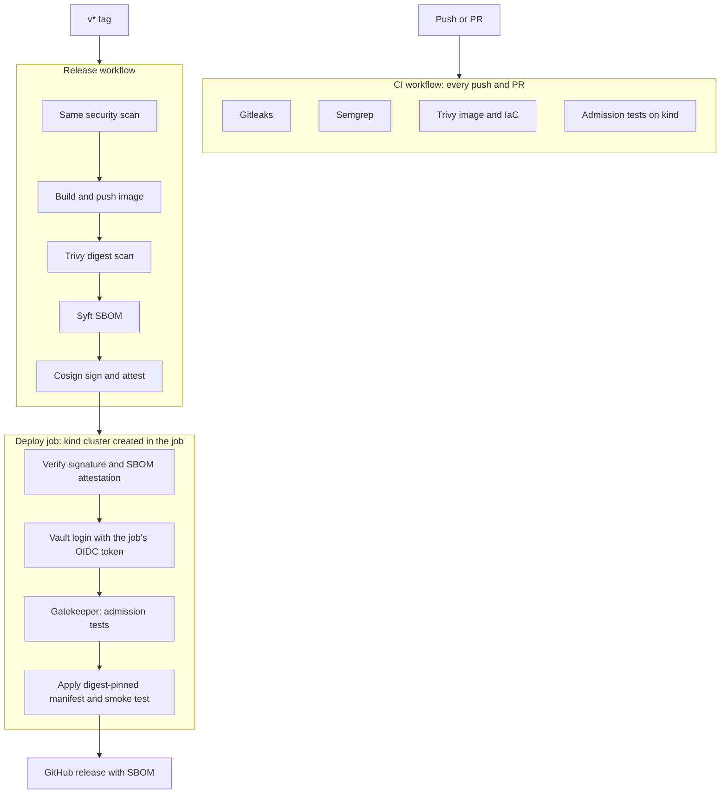

# DevSecOps Hardened Pipeline

Reusable GitHub Actions workflows that scan, sign, attest and deploy a small Flask service. Each release runs the whole chain, from signature verification to an HTTP response, on a kind cluster with Gatekeeper enforcing admission policy. The tradeoff behind each control is documented in an ADR.

## Architecture



## Security Controls

| Tool | What it protects | Threat addressed | Where it runs |
| --- | --- | --- | --- |
| Gitleaks | Git history and staged commits | Secret sprawl and accidental credential commits | Pre-commit and CI |
| Semgrep | Application source code | Committed secrets (blocking), taint-style command injection (blocking), advisory SAST findings | CI |
| Trivy | Container image and Kubernetes manifests | Vulnerable packages and insecure deployment configuration | CI and release (pushed digest) |
| Syft | Released container image | Missing software inventory and weak incident response visibility | Release |
| Cosign | Pushed image and SBOM attestation | Registry tampering and unsigned deployment artifacts | Release; verified before deploy |
| Vault JWT auth | Deployment-time secret access | Static CI secrets and long-lived tokens | Release deploy job |
| Gatekeeper | Cluster admission layer | Root containers, missing limits, untrusted or tag-only images | kind cluster in CI and in the release deploy |

## What Each Run Proves

**On every push and pull request** (`ci.yml`): the security scan, ShellCheck, and the admission tests. `scripts/ci/kind-up.sh` creates a kind cluster, installs Gatekeeper with the three constraints in `deny`, and waits until each one denies requests. Then `scripts/ci/admission-tests.sh` sends the real Deployment to the API server as a server-side dry run, changing one thing per case:

| Case | Expected |
| --- | --- |
| Trusted registry, pinned by digest | admitted |
| Trusted registry, tag only | denied: must be pinned by digest |
| Foreign registry, pinned by digest | denied: must come from an approved registry prefix |
| `runAsNonRoot` removed | denied by `require-runasnonroot` |
| Resource limits removed | denied by `require-resource-limits` |

**On a `v*` tag** (`release.yml`): the same scan, then build and push, a Trivy scan of the pushed digest, SBOM, signature and attestation. The deploy job then does the following on a kind cluster created in the job:

1. Verifies the signature and SBOM attestation. The signer must be `image-sign.yml` in this repository, and the caller must be this repository.
2. Starts a dev-mode Vault, configures it with `vault/config/jwt-auth-config.sh`, and revokes the root token. The job then logs in with its own OIDC token, reads `secret/ci/demo`, and shows that reads elsewhere are denied. It also shows that a role bound to `main` instead of the job's environment rejects the same token ([ADR-003](docs/architecture/ADR-003-vault-auth-method.md)).
3. Runs the admission tests above against the real digest.
4. Applies the manifest, waits for the rollout and calls `/healthz`, `/readyz` and `/api/v1/info` through the Service.

When every stage is green, the GitHub release is created with the SBOM attached.

## Why These Decisions

- Deployment target: [ADR-006](docs/architecture/ADR-006-kind-in-ci-deploy-target.md) (supersedes [ADR-001](docs/architecture/ADR-001-deployment-target.md))
- Keyless signing: [ADR-002](docs/architecture/ADR-002-keyless-signing-vs-keypair.md)
- Vault auth method: [ADR-003](docs/architecture/ADR-003-vault-auth-method.md)
- Gatekeeper policy scope: [ADR-004](docs/architecture/ADR-004-opa-policy-scope.md)
- SBOM format selection: [ADR-005](docs/architecture/ADR-005-sbom-format-selection.md)
- Threats and what each control does not solve: [threat model](docs/threat-model.md)

## Reusing the Workflows From Another Repository

`security-scan.yml` and `image-sign.yml` can be called from other repositories. Pin them to a tag and pass the same tag as `policy-ref`, so the shared Semgrep rules, Gitleaks config and scripts come from the same version:

```yaml
jobs:
  scan:
    uses: Ignatius-Kevin-Wijaya/devsecops-hardened-pipeline/.github/workflows/security-scan.yml@<tag>
    with:
      image-name: my-app
      registry: ghcr.io/my-org
      policy-ref: <tag>
      source-path: app/          # defaults: src/, k8s/, Dockerfile, .
      k8s-path: deploy/
    permissions:
      contents: read
      security-events: write
```

Keyless certificates name the workflow that signed, which is `image-sign.yml` in this repository, not the caller. Anyone can call a public reusable workflow, so a verifier must check the caller too:

```bash
cosign verify \
  --certificate-identity-regexp '^https://github\.com/Ignatius-Kevin-Wijaya/devsecops-hardened-pipeline/\.github/workflows/image-sign\.yml@' \
  --certificate-oidc-issuer https://token.actions.githubusercontent.com \
  --certificate-github-workflow-repository <caller-owner>/<caller-repo> \
  <image>@sha256:<digest>
```

`deploy.yml` is specific to this repository and is not meant to be called from elsewhere.

## Repository Layout

```text
.
├── .github/workflows     ci, release, and the reusable scan, sign and deploy workflows
├── docs/architecture     ADRs
├── docs/threat-model.md
├── k8s                   Deployment, Service, NetworkPolicy
├── policies/gatekeeper   ConstraintTemplates and constraints
├── policies/semgrep      custom taint rule
├── scripts/ci            kind + Gatekeeper setup, admission tests
├── scripts/query-sbom.py
├── src                   Flask service
├── tests/semgrep         fixtures for the custom rule
└── vault/config          JWT auth setup and policy
```

## Local Run

```bash
python3 -m venv .venv
source .venv/bin/activate
pip install -r src/requirements.txt
python3 src/app.py
```

The service exposes:

- `GET /healthz`
- `GET /readyz`
- `GET /api/v1/info`

## Local Security Checks

```bash
docker build -t devsecops-demo:local .
python3 scripts/query-sbom.py sbom.cyclonedx.json
```

```bash
pre-commit run --all-files
semgrep scan --config policies/semgrep tests/semgrep
```

The admission tests also run locally on Linux x86-64 with Docker:

```bash
bash scripts/ci/kind-up.sh
bash scripts/ci/admission-tests.sh "ghcr.io/ignatius-kevin-wijaya/devsecops-demo@sha256:$(printf '0%.0s' $(seq 64))"
kind delete cluster --name devsecops-ci
```

## Deployment Notes

- The checked-in manifest keeps a non-runnable `release-placeholder` tag. The deploy job replaces it with the pushed digest, and Gatekeeper would deny the placeholder anyway.
- The image runs as UID 10001 with a read-only root filesystem; gunicorn keeps its worker heartbeat files in `/dev/shm`.
- The kind cluster pulls the image with the deploy job's `GITHUB_TOKEN`, so this works whether the GHCR package is public or private.
